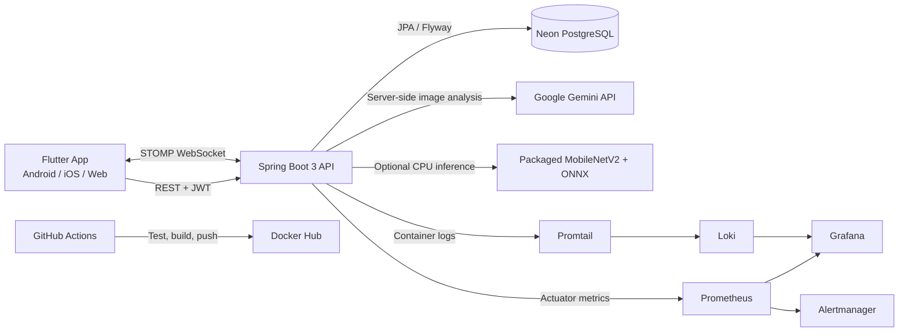

# EcoVision

<div align="center">

**AI-powered zero-waste intelligence, community action, and measurable eco-impact.**

[](https://flutter.dev/)
[](https://spring.io/projects/spring-boot)
[](https://openjdk.org/)
[](https://neon.tech/)
[](https://www.docker.com/)
[](https://kubernetes.io/)
[](https://prometheus.io/)
[](https://grafana.com/)
[](https://github.com/features/actions)

</div>

## Overview

### Jury Preview

**Latest APK: 1.0.2 (build 3), 25 October 2026.**

[Download the latest Android APK](https://github.com/BnymGnc/EcoVision/releases/download/jury-2026-10-25-gps/EcoVision-jury-arm64.apk)
or open the [GPS and recycling release](https://github.com/BnymGnc/EcoVision/releases/tag/jury-2026-10-25-gps).
Android 7.0+ ARM64, internet required. Create a normal account in the app;
no administrator credentials are needed. This release-mode preview uses the
project's existing debug signing key, not Play Store production signing.
The public download was verified against the build's SHA256; see the
[GPS/recycling artifact verification](docs/jury-artifact-gps-verification.json).
Backend cold starts or service interruptions remain possible; this is not
an uptime guarantee. The preview does not certify physical recycling or DOA acceptance.

For the 26 October keep-alive incident, actual shutdown/restart evidence,
JVM startup defaults and cron recovery instructions, see the
[incident report](docs/incident-2026-10-26-tr.md). Render Free can spin down
or restart; an external ping is not an always-on service guarantee.

The mobile update retains the scanning animation fitted to all four themes and
screen sizes, bounds map searches to 1-50 km and zoom to 3-18, and caches
marker groups with a 300-point display limit. The **All Cities** leaderboard defaults to
all users, with an optional city filter. See the [final mobile fixes and 146-test results](docs/final-mobile-polish-tr.md).

The previous update's mutually exclusive numeric/survey carbon answers and
saved annual estimate remain included: [carbon and leaderboard notes](docs/leaderboard-carbon-update-tr.md).
Physical-device frame timing/ANR verification is still required; automated
map tests and a local clustering benchmark do not guarantee FPS on every phone.

### Latest source update: GPS-based nearby points and recycling potential

Nearby DOA searches now stay anchored to the user's GPS location, not the
map camera. Panning/zooming does not issue another search or replace nearby
results. Refresh obtains GPS again; if that fails, a known real position is
retained with a warning. The 1-50 km radius, bounded tiles and cached clusters
remain. Results arrive in 100-point pages, in windows of up to 300 markers;
Next/Previous controls provide access to the rest without loading all points
into phone memory. No source points were deleted: **4,037 points**, including
**2,162 DIM machines**, remain in the canonical snapshot.

The profile keeps the annual footprint calculator and adds a separate
**Total Recycling** card. `/api/carbon/summary` now includes
`recyclingPotential`: unique rewarded recyclable scans, modeled/unmodeled
counts, a material breakdown and illustrative CO2e potential. This is **not
measured recycling or verified emissions savings**. Explicit PET/glass/aluminum
classes use application-defined scenario masses (25/200/15 g per scan) and
the existing EPA WARM v13 landfill-to-recycling factors. Generic plastic/metal
are not guessed; unsupported legacy records remain visible in the count but
excluded from the CO2e subtotal. The same image hash counts once per user.
Annual footprint, declared actions and XP are not subtracted or changed.

The additive V7 migration preserves existing rows and introduces only a
nullable material key. The APK linked above includes this client update;
the new summary field was also observed in the live backend's OpenAPI schema
after deployment. Health HTTP 200 alone is not used as deployment proof.
See [GPS and recycling update notes](docs/gps-recycling-update-tr.md).

EcoVision is a full-stack Green Tech platform that turns everyday sustainability into an accessible, social, and rewarding experience. Its Flutter application lets users analyze waste images with AI, discover compatible reverse-vending and recycling machines, learn through an interactive Eco-Academy, track environmental impact, complete quests, evolve avatars, and participate in community groups and cleanup events.

The platform combines a cross-platform Flutter client with a Spring Boot 3 REST and WebSocket backend. Data is stored in PostgreSQL (Neon in the deployment configuration). Image analysis supports server-side Gemini or a packaged, actually trained MobileNetV2/TrashNet ONNX classifier. XP rewards in-app participation; it is not evidence of a physical return or measured emissions savings.

**Pitch focus:** photo → material estimate and uncertainty → sorting guidance → relevant DOA point → directions. Education and gamification support this loop. EcoVision is not the official DOA application and does not process deposit payments.

See the [Turkish product audit and priorities](docs/climathon-readiness-tr.md), [screen-by-screen inventory](docs/features-and-changes-tr.md), [model card](ml/MODEL_CARD.md), and [verification log](docs/verification.md).

Final delivery status, live-check limits, and the exact Render configuration:
[25 October delivery checklist](docs/final-delivery-2026-10-25-tr.md).
On Windows Unicode paths, use `powershell -File scripts/build_web.ps1` for the release web bundle.

For the complete Turkish **screen → button → API → service → response** walkthrough,
read [Architecture and Interaction Flows](docs/ecovision-architecture-and-flows-tr.md).
The companion [API and DTO Inventory](docs/api-route-inventory-tr.md) lists every
controller route, request signature and declared response contract directly from source.

Latest [25 October UI and compatibility changes](docs/ui-fixes-2026-10-25-tr.md):
bounded scanner animation, Render map-route compatibility, simplified map controls,
inline numeric carbon answers and narrow-screen mission scrolling fixes.

Latest [UI/data/performance audit](docs/ui-review-and-performance-tr.md): shared
81-province/973-district catalog, corrected Community refresh, bounded startup
requests, purchase/privacy guards and batched quest evaluation. The
[province inventory](docs/doa-city-counts-tr.md) separates 2,162 DIM machines
from other DOA point types and identifies unresolved source addresses.

See the [final local audit](docs/ecovision-final-audit-tr.md) for the complete
81-province/973-district validation, paged city-based map discovery, STOMP
identity fix, one-reward-per-photo policy, theme persistence and verified build
results. These are local checks, not a live Render/Neon deployment claim.

### Core capabilities

- **AI waste recognition:** multipart image analysis through the backend, using configurable Gemini or local ONNX inference. Provider, model version, cached mode and uncertainty are returned; credentials never belong in the Flutter client.
- **Smart recycling map:** OpenStreetMap-based RVM discovery with material support, timestamped source-bin state, radius/viewport limits, and navigation support. Source state is not live acceptance confirmation.
- **Eco-Academy:** 10 searchable Turkish modules, 30 questions, practical sorting checklists, safety notes and source links. Versioned answers are graded by the server before the idempotent reward.
- **Gamification:** quests, badges, streaks, Eco Points, avatar evolution, leaderboards, and an Eco-Market.
- **Carbon footprint engine:** a 20-question approximate annual survey, with optional fuel/electricity inputs replacing overlapping answer weights. It is not a certified emissions inventory or a carbon offset.
- **Community platform:** age-aware groups, role-based moderation, group chat, media, polls, events, RSVP flows, and member management.
- **Social profiles:** privacy-aware avatars and profile photos, friends, likes, notifications, and public profile controls.
- **Production observability:** health checks, JVM/application metrics, centralized logs, alerting, dashboards, and static analysis.

## Architecture & Tech Stack

EcoVision is organized as a clean monorepo with a modular monolithic backend. The mobile/web client communicates with the backend through secured REST endpoints and STOMP/WebSocket channels. The backend owns authentication, authorization, persistence, AI orchestration, point validation, and business rules.



### Frontend

| Area | Technology |
| --- | --- |
| Application | Flutter, Dart, Material 3 |
| Networking | `http`, multipart requests, STOMP WebSockets |
| Authentication storage | `flutter_secure_storage` |
| Maps and location | `flutter_map`, OpenStreetMap, `latlong2`, `geolocator`, `geocoding` |
| Media | `image_picker`, `file_picker`, `image` compression |
| Experience | Lottie, Animated Text Kit, Shimmer, Google Fonts, haptic interactions |
| Local preferences | `shared_preferences` for account-scoped UI preferences |
| Platform integrations | `url_launcher`, `share_plus` |

### Backend

| Area | Technology |
| --- | --- |
| Runtime | Java 17, Spring Boot 3, Maven Wrapper |
| API layer | Spring MVC REST APIs and springdoc OpenAPI |
| Security | Spring Security, BCrypt, JWT access/refresh tokens, role-based authorization |
| Persistence | Spring Data JPA, Hibernate, Flyway |
| Database | Neon Serverless PostgreSQL over SSL |
| Real-time communication | Spring WebSocket and STOMP |
| AI integration | Google Gemini multimodal API or Java ONNX Runtime with packaged MobileNetV2/TrashNet classifier |
| Monitoring | Spring Boot Actuator and Micrometer Prometheus registry |

### DevOps, quality, and observability

| Capability | Tooling |
| --- | --- |
| Containerization | Multi-stage Docker build and Docker Compose |
| Orchestration | Kubernetes manifests for Deployment, Service, PostgreSQL, PVC, and Secrets integration |
| Metrics | Prometheus scraping `/actuator/prometheus` every 15 seconds |
| Dashboards | Grafana |
| Centralized logging | Promtail, Loki, and Grafana, commonly known as the PLG stack |
| Alerting | Prometheus rules and Alertmanager webhook routing |
| Static analysis | SonarQube Community Edition |
| CI/CD | GitHub Actions: test, Docker build, and Docker Hub push on `main` |

### Request and authorization flow

1. The Flutter client authenticates with email and password over the REST API.
2. Spring Security verifies BCrypt password hashes and issues short-lived access and long-lived refresh tokens.
3. The client stores tokens in secure platform storage and sends the access token as `Authorization: Bearer <token>`.
4. The JWT filter restores the authenticated principal and roles for each protected request.
5. Controllers and method-level authorization enforce user, group-admin, admin, and superuser permissions.
6. Services validate sensitive rules server-side, including point awards, quest claims, group permissions, and scan limits.
7. JPA repositories persist domain changes to PostgreSQL; Flyway applies versioned schema migrations. The production profile validates the Hibernate schema instead of silently editing it.

## AI, Data & Evidence

| Item | What is actually available |
| --- | --- |
| Local visual model | Frozen MobileNetV2 features + a trained linear classifier, bundled as ONNX; not on-device TFLite |
| Classes | Cardboard, glass, metal, paper, plastic, other; generic plastic is not verified PET, generic metal is not verified aluminum |
| Held-out test | 395 images; accuracy 0.8253, macro-F1 0.7881; not field accuracy |
| Uncertainty | Score threshold 0.65; 20.51% of this test set rejected, retained-subset accuracy 0.9140; scores are not calibrated probabilities |
| DOA source snapshot | 4,037 points on 24 October 2026: 2,162 DIM machines, 1,764 MIN centers, 111 SDM bulk centers; not 4,037 vending machines |
| Map freshness | Snapshot-based location/material information, not a guaranteed live machine feed |
| Impact | XP, scan counts, approximate footprint and user-declared scenario estimates are separate |
| Field outcomes | No measured campus baseline, verified return integration or causal waste-reduction result yet |

Model provenance, licences, split strategy and limitations are documented in [MODEL_CARD.md](ml/MODEL_CARD.md). The [DOA manifest](backend/src/main/resources/data/data/manifest.json) records the source and collection time; [read-only database verification](docs/doa-count-verification.json) records a point-in-time catalog comparison, not an ongoing production guarantee.

### Choose an AI provider

For the packaged model, no Gemini key is required:

```dotenv
AI_PROVIDER=local
ML_ENABLED=true
GEMINI_ON_UNCERTAIN_ENABLED=false
```

For Gemini, set `AI_PROVIDER=gemini`, provide `GEMINI_API_KEY` and explicitly select a model accessible to that key using `GEMINI_MODEL`. The example model name is configuration, not proof that your account can use it. Never silently replace a failed provider response with a demonstration result.

The local model has no separate electronics, oil, organic, textile or medical class, and is not validated for multiple objects or hazard detection. Consult the guide rather than treating a score as a safety decision. AI provides visual classification; map distance, deposit rules, XP and carbon arithmetic are deterministic.

## Repository Structure

```text
EcoVision/
|-- backend/                    # Spring Boot application, Maven wrapper, Dockerfile
|-- frontend/                   # Flutter application for Android, iOS, and Web
|-- k8s/                        # Kubernetes deployments, services, and database manifests
|-- .github/workflows/main.yml  # Backend CI/CD pipeline
|-- docker-compose.yml          # Application and observability stack
|-- prometheus.yml              # Metrics scrape configuration
|-- alert-rules.yml             # Availability and JVM memory alerts
|-- alertmanager.yml            # Alert routing and webhook configuration
|-- loki-config.yml             # Central log storage configuration
|-- promtail-config.yml         # Docker log collection pipeline
`-- .env.example                # Safe environment-variable template
```

## Getting Started

### Prerequisites

- Docker Desktop or Docker Engine with Docker Compose v2
- A Neon PostgreSQL project and pooled database credentials
- A Gemini API key for cloud analysis, **or** enable the packaged local model
- Git
- Flutter SDK only when running the mobile or web client locally

For Android, use **JDK 17 or 21** (the locally verified Android Studio JBR is 21), not Java 25,
with the checked-in Gradle 8.12 wrapper and AGP 8.10.1. See the
[Android build/IDE troubleshooting guide](docs/android-build-and-ide-tr.md).
On Windows, `powershell -NoProfile -ExecutionPolicy Bypass -File
.\scripts\build_android.ps1` creates a key-free isolated ARM64 debug build
and places the APK under `frontend/build/app/outputs/flutter-apk/`.
Pass `-JavaHome 'C:\path\to\jdk-17'` to select JDK 17 explicitly. `-Mode release`
also checks the release build, but the current project uses debug signing and
is not ready for store publication. The backend always targets Java 17.
Do not let an IDE compiler overwrite Maven's `target/classes` with a different
Java target; use `./mvnw clean verify` after switching toolchains.

### 1. Clone the repository

```bash
git clone https://github.com/BnymGnc/EcoVision.git
cd EcoVision
```

### 2. Create the environment file

Copy the committed template into a local `.env` file:

```bash
cp .env.example .env
```

PowerShell equivalent:

```powershell
Copy-Item .env.example .env
```

Set the required values without committing the file:

```dotenv
NEON_DB_HOST=your-neon-pooler-host
NEON_DB_PORT=5432
NEON_DB_NAME=neondb
NEON_DB_USERNAME=your-neon-username
NEON_DB_PASSWORD=your-neon-password

SPRING_DATASOURCE_URL=jdbc:postgresql://${NEON_DB_HOST}:${NEON_DB_PORT}/${NEON_DB_NAME}?sslmode=require&channelBinding=require
SPRING_DATASOURCE_USERNAME=${NEON_DB_USERNAME}
SPRING_DATASOURCE_PASSWORD=${NEON_DB_PASSWORD}

JWT_SECRET=replace-with-a-cryptographically-random-secret-of-at-least-32-characters
GEMINI_API_KEY=replace-with-your-gemini-api-key
PUBLIC_BASE_URL=http://localhost:8080
```

Generate a suitable JWT secret locally, for example:

```bash
openssl rand -base64 48
```

> [!CAUTION]
> Never commit `.env`, database credentials, JWT secrets, Gemini keys, webhook URLs, or mobile constants containing secrets. The repository `.gitignore` excludes local environment files.

### 3. Start the complete backend platform

```bash
docker compose up -d
```

This single command starts the Spring Boot backend and the complete local observability and quality stack. The database remains externally hosted by Neon, so no local PostgreSQL container is required.

To rebuild the backend image after source changes:

```bash
docker compose up -d --build
```

Inspect service status and backend logs:

```bash
docker compose ps
docker compose logs -f ecovision-backend
```

### 4. Verify the platform

| Service | URL | Purpose |
| --- | --- | --- |
| EcoVision API | [http://localhost:8080](http://localhost:8080) | Spring Boot backend |
| Health check | [http://localhost:8080/actuator/health](http://localhost:8080/actuator/health) | Application availability |
| Prometheus metrics | [http://localhost:8080/actuator/prometheus](http://localhost:8080/actuator/prometheus) | Raw Micrometer metrics |
| Prometheus | [http://localhost:9090](http://localhost:9090) | Metric queries and alert rules |
| Grafana | [http://localhost:3000](http://localhost:3000) | Metrics and log dashboards |
| Alertmanager | [http://localhost:9093](http://localhost:9093) | Alert routing and delivery |
| Loki | [http://localhost:3100/ready](http://localhost:3100/ready) | Central log store readiness |
| SonarQube | [http://localhost:9000](http://localhost:9000) | Static analysis and quality gates |

Grafana is initialized for local development with username `admin` and password `admin`. Change this credential before exposing the service beyond localhost. Add Prometheus as `http://prometheus:9090` and Loki as `http://loki:3100` when configuring Grafana data sources from inside the Compose network.

### 5. Run the Flutter client

Docker Compose runs the backend platform and infrastructure. Run the Flutter client separately on the desired target:

```bash
cd frontend
cp lib/core/constants.example.dart lib/core/constants.dart
flutter pub get
flutter run --dart-define=API_BASE_URL=http://127.0.0.1:8080
```

Examples:

```bash
flutter run -d chrome --dart-define=API_BASE_URL=http://127.0.0.1:8080
flutter run -d <android-device-id> --dart-define=API_BASE_URL=http://<computer-lan-ip>:8080
```

PowerShell template-copy command: `Copy-Item lib/core/constants.example.dart lib/core/constants.dart`. This ignored file contains public client settings only, never a Gemini key. Flutter does not read the root `.env`; pass `API_BASE_URL` at build/run time. Without an override the client targets the configured Render URL. Android emulators commonly reach the host through `http://10.0.2.2:8080`. Physical phones need a reachable LAN IP or deployed HTTPS endpoint.

### Stop the stack

```bash
docker compose down
```

Persistent Loki, Promtail, and SonarQube data are retained in named Docker volumes. Add `-v` only when you intentionally want to delete those local volumes.

## API Docs

Interactive OpenAPI documentation is available after the backend starts:

**Swagger UI:** [http://localhost:8080/swagger-ui.html](http://localhost:8080/swagger-ui.html)

Use Swagger UI to inspect request schemas, execute public endpoints, and test protected APIs:

1. Authenticate through the relevant `/api/auth` endpoint.
2. Copy the returned access token.
3. Select **Authorize** in Swagger UI.
4. Enter `Bearer <access-token>` if the generated security dialog does not add the prefix automatically.
5. Execute protected requests and review their status codes and response payloads.

The generated OpenAPI document is available at [http://localhost:8080/v3/api-docs](http://localhost:8080/v3/api-docs).

## Monitoring & Alerting

Prometheus scrapes the backend every 15 seconds through the Docker network at `ecovision-backend:8080/actuator/prometheus`. Current alert rules include:

- Backend instance unavailable.
- JVM memory utilization above 80 percent.

Before using notifications, replace the placeholder webhook receiver in `alertmanager.yml` with a protected Discord, Telegram gateway, or compatible webhook endpoint. Do not commit a real webhook secret.

## CI/CD

Every push to `main` triggers `.github/workflows/main.yml`:

1. Checks out the repository.
2. Installs Temurin JDK 17.
3. Runs `./mvnw clean test` inside `backend/`.
4. Authenticates with Docker Hub after successful tests.
5. Builds `backend/Dockerfile`.
6. Pushes `<DOCKER_USERNAME>/ecovision-backend:latest`.

Configure these encrypted GitHub Actions secrets before enabling image publication:

- `DOCKER_USERNAME`
- `DOCKER_PASSWORD`

## Kubernetes

The `k8s/` directory contains manifests for a replicated backend deployment, external service exposure, PostgreSQL deployment, persistent storage, and ClusterIP database access. Kubernetes credentials are read from the `ecovision-secrets` Secret and must never be embedded directly in version-controlled manifests.

Read the [cluster deployment prerequisites and limitations](k8s/README.md)
before applying these optional templates. They do not migrate the live Neon
database, and two replicas alone do not provide cross-replica STOMP messaging.

```bash
kubectl apply -f k8s/
kubectl get pods
kubectl get services
```

Review image names, ingress/TLS, storage classes, resource requests, secret values, and environment-specific database architecture before using these manifests in production.

## Security Notes

- Secrets are injected through environment variables and excluded from Git.
- Passwords are hashed with BCrypt and never stored as plain text.
- JWT access and refresh tokens protect authenticated API traffic.
- Authorization rules are enforced by Spring Security and role-aware services.
- Gemini image analysis is executed server-side so the API key is not shipped in the Flutter binary.
- Production deployments should enforce HTTPS, narrow CORS origins, rotate credentials, use a non-default Grafana password, and set `JPA_HIBERNATE_DDL_AUTO=validate` once the schema is fully managed by Flyway.

### Security Hardening & Remaining Limits

Do not interpret this README as an enterprise-security certification:

- `POST /api/education/complete/{categoryId}` requires a version and three answers; the server enforces at least 2/3. Body-less old clients receive 426. The client still contains an answer key for feedback, so this does not prove human learning.
- Legacy `POST /api/scans` can log a label but awards zero XP. Verified image analysis awards once per user/exact file hash/Istanbul calendar day, protected by a user lock and a partial unique index. Re-encoded/modified images are not reliably detected as duplicates, and a scan is not a physical return.
- `GET /api/media/{id}` now checks current owner/privacy/friendship/group access before loading the bytes. Only eligible public profile pictures are anonymous-readable. All responses are private/no-store. Flutter uses authorized byte requests and platform PDF saving, never JWTs in media URLs.
- Updated logout revokes the supplied access token as well as the refresh token. Offline logout cannot guarantee immediate server revocation. Previously downloaded or publicly cached copies cannot be recalled.
- Location snapshot support and true/false/unknown bin state have separate labels; material matching remains support-based, never a guarantee of current acceptance.
- The default development profile permits Hibernate schema updates. Review a complete schema baseline before enabling the production `validate` profile on a new database.

Implementation, authorization matrix and migration/compatibility risks are in
[the final security report](docs/final-security-and-tests-tr.md) and
[deployment readiness](docs/deployment-readiness-tr.md). The earlier
[audit](docs/climathon-readiness-tr.md) records the original findings.
No production database was reset. Old unauthenticated private-media clients
must upgrade rather than bypassing authorization.

## Tests & Jury Delivery

```bash
cd backend
./mvnw clean verify
cd ../frontend
flutter test --no-pub
flutter build web --dart-define=API_BASE_URL=https://your-backend.example
```

The PostgreSQL integration suite is opt-in and only accepts the explicitly isolated local test URL documented in [verification.md](docs/verification.md); ordinary test success must not be represented as production end-to-end validation. The Python [browser smoke test](scripts/browser_smoke.py) also only targets the isolated local backend.

For Climathon, prepare a real two-minute screen recording, an accessible working product, final problem definition and PDR. Use [the demo script](docs/demo-script.md) and [submission draft](docs/task4-submission.md). Personal motivation, pilot baseline, financial validation and the unlisted YouTube link must come from actual work; they are not generated evidence.

## License

This repository does not currently declare an open-source license. All rights are reserved unless a license file is added explicitly.
